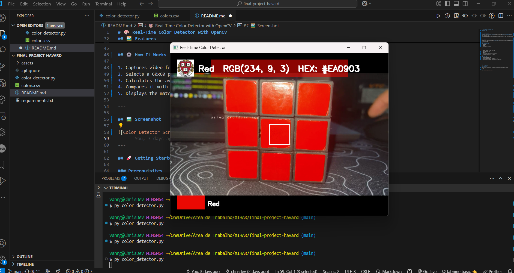

<div align="center">

# 🎨 Real-Time Color Detector

**Point your webcam at anything and get its color name, RGB and HEX, live.**

Built with Python and OpenCV · Final project for [Harvard CS50x](https://cs50.harvard.edu/x/)

[](https://www.python.org/)
[](https://opencv.org/)
[](https://pandas.pydata.org/)
[](https://certificates.cs50.io/81532b44-9b96-4a68-bf98-cd162cff7011.pdf?size=letter)

<br>

<!-- To use a GIF: record the window (ScreenToGif works well), save it as images/demo.gif and swap the src below. -->


<br><br>

[](https://www.youtube.com/watch?v=SoSC_lMgSrE)

</div>

<br>

## ✨ Features

| | |
|---|---|
| 📷 **Live webcam feed** | Reads every frame in real time, no photo upload needed |
| 🎯 **Center sampling** | Averages a 60×60 px area instead of a single pixel, so noise doesn't flip the result |
| 🌈 **Name + RGB + HEX** | Matches the nearest of 141 named colors and shows all three values on screen |
| 🧠 **Smart contrast** | Text switches between black and white depending on how bright the color is |
| 🖼️ **Clean overlay** | Translucent color panel, swatch preview and PNG logo with real alpha blending |

<br>

## 🚀 Quick start

```bash
git clone https://github.com/vanngilha/color-detector.git
cd color-detector
pip install -r requirements.txt
python color_detector.py
```

A window opens with your webcam. Put something in the white square and the color shows up on top. Press **Esc** to quit.

> [!TIP]
> No webcam on your PC? Apps like **DroidCam** turn your phone into one. That's how the screenshot above was taken.

> [!NOTE]
> Online IDEs (like the CS50 codespace) can't reach your webcam. Run it locally in VS Code or a terminal.

<br>

## ⚙️ How it works


1. Each frame is captured with `cv2.VideoCapture`.
2. The square in the middle of the frame is averaged into one color.
3. That color is compared with every row in `colors.csv` using the sum of the absolute differences in R, G and B. The smallest difference wins.
4. The name, RGB and HEX are drawn on the frame with OpenCV, and the loop repeats.

<br>

## 📁 Project structure

```
color-detector/
├── color_detector.py   # capture, color matching and drawing
├── colors.csv          # 141 named colors with HEX and RGB
├── requirements.txt    # opencv-python, pandas
├── assets/
│   └── harvard_logo.png
└── images/
    └── final-project-havard.png
```

Want more colors? Add a row to `colors.csv` (`color_name,hex,R,G,B`). No code changes needed.

<br>

## 🔮 Roadmap

- [ ] Click anywhere on the video to pick that point's color
- [ ] Save detected colors as a palette (PNG / JSON)
- [ ] Grid mode to detect several regions at once
- [ ] Web version in JavaScript with WebRTC

Ideas and PRs are welcome. Open an [issue](https://github.com/vanngilha/color-detector/issues) and let's talk.

<br>

<div align="center">

**If this project helped you or you just liked it, leave a ⭐. It really helps!**

Made by [Christopher Oliveira](https://www.chrisoliveira.dev) · [LinkedIn](https://www.linkedin.com/in/chriisoliveira)

</div>
